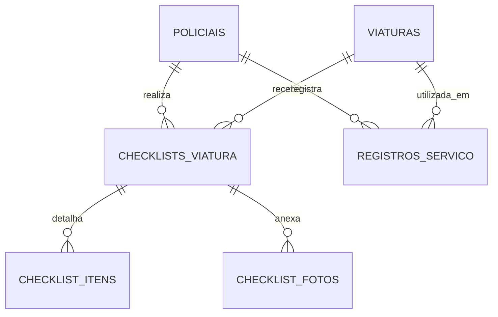

# Sistema de Controle de Frota PMBA

**Disciplina:** Banco de Dados — Prof. Vagner  
**Autor:** Caio Barreto ([LinkedIn](https://www.linkedin.com/in/caio-barreto-50625a254/))  
**SGBD:** PostgreSQL 15+  
**Stack Full-Stack:** PostgreSQL • API REST Node.js / Express • Aplicativo Flutter (Material 3 / Dart `^3.13.2`)

---

## Visão Geral do Projeto

Solução integrada para substituir fichas de pátio e cadernos manuais de plantão por um sistema relacional auditável para gestão de viaturas policiais (`CARRO` e `MOTO`). O banco de dados centraliza o cadastro da frota, controle de efetivo por perfil (`ADMIN` e `POLICIAL`), vistorias duplas (`SAIDA` e `RETORNO`) com itens individuais e até 5 evidências fotográficas, além de registros consolidados de quilometragem, abastecimento e alertas automáticos de revisão preventiva.

---

## Documentação e Scripts SQL (Entrega da Banca)

| Artefato | Descrição | Acesso Direto |
|---|---|---|
| **Documentação Completa (Markdown)** | Mini-mundo, regras de negócio (`RN01`–`RN06`), DER em Mermaid, modelo lógico, dicionário das 6 tabelas, normalização (`1FN`–`3FN`), índices e análise das queries | [docs/DOCUMENTACAO_BANCO_DE_DADOS.md](docs/DOCUMENTACAO_BANCO_DE_DADOS.md) |
| **Documentação Técnica Oficial (Word)** | Documento completo no template institucional UniRuy Wyden | [docs/Documentacao_Tecnica_Uniruy_Controle_Frota.docx](docs/Documentacao_Tecnica_Uniruy_Controle_Frota.docx) |
| **Slides da Apresentação** | Apresentação de 12 slides utilizada na defesa da banca | [docs/Apresentacao_BD_Controle_Frota.pptx](docs/Apresentacao_BD_Controle_Frota.pptx) |
| **Script DDL** | Criação das 6 tabelas, PKs, FKs (`ON DELETE CASCADE` / `ON UPDATE CASCADE`), `UNIQUE`, `CHECK` e 8 índices B-Tree | [scripts/01_ddl.sql](scripts/01_ddl.sql) |
| **Script DML** | Carga inicial de teste (policiais, viaturas, checklists, itens, fotos, turnos) + exemplos de `UPDATE` e `DELETE` | [scripts/02_dml.sql](scripts/02_dml.sql) |
| **Script DQL** | 10 consultas analíticas e operacionais (`CASE`, `JOIN`, `GROUP BY`, `HAVING`, *self-join* e `json_agg`) | [scripts/03_dql.sql](scripts/03_dql.sql) |

---

## Como Executar os Scripts SQL (PostgreSQL 15+)

Execute os três scripts na ordem abaixo em um banco PostgreSQL limpo (via `psql`, pgAdmin 4 ou DBeaver):

```bash
psql -U postgres -d controle_frota -f scripts/01_ddl.sql
psql -U postgres -d controle_frota -f scripts/02_dml.sql
psql -U postgres -d controle_frota -f scripts/03_dql.sql
```

---

## Visão Rápida do Banco de Dados (6 Tabelas e 8 Índices)



| Tabela | Função Principal | Restrições e Destaques |
|---|---|---|
| `viaturas` | Frota (`CARRO` / `MOTO`) e metas de revisão | `UNIQUE(prefixo)`, `UNIQUE(placa)`, `CHECK(km_atual >= 0)` |
| `policiais` | Efetivo autenticado (`ADMIN` / `POLICIAL`) | `UNIQUE(matricula)`, senha em `bcrypt`, `soft delete` (`ativo`) |
| `checklists_viatura` | Cabeçalho das vistorias `SAIDA` e `RETORNO` | FKs para `viaturas(id)` e `policiais(matricula)` |
| `checklist_itens` | Avaliação granular por componente vistoriado | `ON DELETE CASCADE`, `CHECK(status IN ('OK','PROBLEMA'))` |
| `checklist_fotos` | Evidências visuais (até 5 fotos por irregularidade) | `ON DELETE CASCADE`, indexada por `idx_checklist_fotos_checklist_id` |
| `registros_servico` | Turnos, hodômetro, abastecimento (litros e R$) e ocorrências | `CHECK(km_final >= km_inicial)`, snapshot histórico de nome e placa |

---

## Estrutura do Aplicativo Flutter (`lib/`)

- **Telas principais:**
  - `lib/login.dart` — Autenticação por matrícula e senha com validação alfanumérica e JWT.
  - `lib/formulario_viatura.dart` — Tela operacional do turno (seleção de viatura, checklist obrigatório de saída e devolução, quilometragem e envio).
  - `lib/viaturas.dart` — Listagem de frota com status de manutenção preventiva, cadastro/edição (`ADMIN`) e vistoria dupla (`ChecklistViaturaPage`).
  - `lib/historico.dart` — Consulta de registros ("Meus Registros" e Histórico Geral), filtros por período e exportação `.xlsx`.
  - `lib/gerenciar_policiais.dart` — Administração de policiais com foto de perfil (`ADMIN`).
- **Modelos e Serviços (`lib/models/`, `lib/services/`):**
  - `ViaturaModel`, `ChecklistViaturaModel`, `ChecklistItemModel`, `RegistroServicoModel` e `PolicialModel`.
  - `SessionManager` (`flutter_secure_storage`) para persistência segura de sessão e cabeçalhos autenticados.
  - `ExcelExporter` (`excel` + `path_provider` + `share_plus`) para geração offline e compartilhamento de planilhas `.xlsx`.
- **Widgets reutilizáveis (`lib/widgets/`):**
  - `FundoPMBA` (identidade visual) e `SeletorFotosWidget` (câmera/galeria com limite de até 5 imagens).

---

## Segurança

- Senhas protegidas com hash **bcrypt** no PostgreSQL e tokens **JWT** armazenados em **Android Keystore / iOS Keychain** via `flutter_secure_storage`.
- Comunicação sobre **HTTPS** com cabeçalhos autenticados unificados, controle de acesso por perfil (`ADMIN` vs `POLICIAL`) e transações SQL atômicas (`BEGIN / COMMIT / ROLLBACK`).
