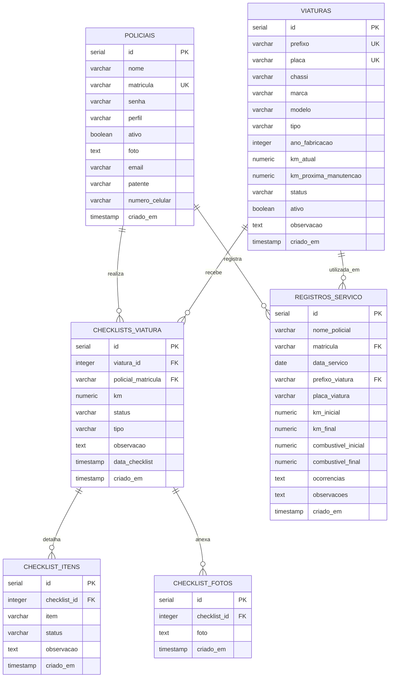

# Banco de Dados

O backend usa PostgreSQL 15+ com seis tabelas relacionais e oito índices B-Tree. Todos os scripts de criação, carga de exemplo e consulta estão na pasta [scripts/](../scripts/).

## Diagrama ER



## Tabelas

### `viaturas`
| Coluna | Tipo | Regras |
|---|---|---|
| `id` | `SERIAL` | `PRIMARY KEY` |
| `prefixo` | `VARCHAR(10)` | `NOT NULL UNIQUE` |
| `placa` | `VARCHAR(10)` | `NOT NULL UNIQUE` |
| `chassi` | `VARCHAR(50)` | Opcional |
| `marca` | `VARCHAR(50)` | Opcional |
| `modelo` | `VARCHAR(50)` | Opcional |
| `tipo` | `VARCHAR(20)` | `NOT NULL`, `CHECK (tipo IN ('CARRO', 'MOTO'))` |
| `ano_fabricacao` | `INTEGER` | `CHECK (ano_fabricacao BETWEEN 1980 AND 2100)` |
| `km_atual` | `NUMERIC(12, 2)` | `NOT NULL DEFAULT 0`, `CHECK (km_atual >= 0)` |
| `km_proxima_manutencao` | `NUMERIC(12, 2)` | `NOT NULL DEFAULT 10000`, `CHECK (km_proxima_manutencao >= 0)` |
| `status` | `VARCHAR(20)` | `NOT NULL DEFAULT 'DISPONÍVEL'`, `CHECK` (`DISPONÍVEL`, `EM MANUTENÇÃO`, `RESERVA`, `BAIXADA`) |
| `ativo` | `BOOLEAN` | `NOT NULL DEFAULT TRUE` |
| `observacao` | `TEXT` | Opcional |
| `criado_em` | `TIMESTAMP` | `NOT NULL DEFAULT NOW()` |

### `policiais`
| Coluna | Tipo | Regras |
|---|---|---|
| `id` | `SERIAL` | `PRIMARY KEY` |
| `nome` | `VARCHAR(200)` | `NOT NULL` |
| `matricula` | `VARCHAR(20)` | `NOT NULL UNIQUE` |
| `senha` | `VARCHAR(200)` | `NOT NULL` (hash bcrypt) |
| `perfil` | `VARCHAR(20)` | `NOT NULL DEFAULT 'POLICIAL'`, `CHECK (perfil IN ('ADMIN', 'POLICIAL'))` |
| `ativo` | `BOOLEAN` | `NOT NULL DEFAULT TRUE` |
| `foto` | `TEXT` | Opcional |
| `email` | `VARCHAR(255)` | Opcional |
| `patente` | `VARCHAR(50)` | Opcional |
| `numero_celular` | `VARCHAR(30)` | Opcional |
| `criado_em` | `TIMESTAMP` | `NOT NULL DEFAULT NOW()` |

### `checklists_viatura`
| Coluna | Tipo | Regras |
|---|---|---|
| `id` | `SERIAL` | `PRIMARY KEY` |
| `viatura_id` | `INTEGER` | `NOT NULL REFERENCES viaturas(id) ON DELETE CASCADE` |
| `policial_matricula` | `VARCHAR(20)` | `NOT NULL REFERENCES policiais(matricula) ON UPDATE CASCADE` |
| `km` | `NUMERIC(12, 2)` | `NOT NULL`, `CHECK (km >= 0)` |
| `status` | `VARCHAR(20)` | `NOT NULL`, `CHECK (status IN ('OK', 'PROBLEMA'))` |
| `tipo` | `VARCHAR(20)` | `NOT NULL DEFAULT 'SAIDA'`, `CHECK (tipo IN ('SAIDA', 'RETORNO'))` |
| `observacao` | `TEXT` | Opcional |
| `data_checklist` | `TIMESTAMP` | `NOT NULL DEFAULT NOW()` |
| `criado_em` | `TIMESTAMP` | `NOT NULL DEFAULT NOW()` |

### `checklist_itens`
| Coluna | Tipo | Regras |
|---|---|---|
| `id` | `SERIAL` | `PRIMARY KEY` |
| `checklist_id` | `INTEGER` | `NOT NULL REFERENCES checklists_viatura(id) ON DELETE CASCADE` |
| `item` | `VARCHAR(200)` | `NOT NULL` |
| `status` | `VARCHAR(20)` | `NOT NULL`, `CHECK (status IN ('OK', 'PROBLEMA'))` |
| `observacao` | `TEXT` | Opcional |
| `criado_em` | `TIMESTAMP` | `NOT NULL DEFAULT NOW()` |

### `checklist_fotos`
| Coluna | Tipo | Regras |
|---|---|---|
| `id` | `SERIAL` | `PRIMARY KEY` |
| `checklist_id` | `INTEGER` | `NOT NULL REFERENCES checklists_viatura(id) ON DELETE CASCADE` |
| `foto` | `TEXT` | `NOT NULL` |
| `criado_em` | `TIMESTAMP` | `NOT NULL DEFAULT NOW()` |

### `registros_servico`
| Coluna | Tipo | Regras |
|---|---|---|
| `id` | `SERIAL` | `PRIMARY KEY` |
| `nome_policial` | `VARCHAR(200)` | `NOT NULL` |
| `matricula` | `VARCHAR(20)` | `NOT NULL REFERENCES policiais(matricula) ON UPDATE CASCADE` |
| `data_servico` | `DATE` | `NOT NULL` |
| `prefixo_viatura` | `VARCHAR(10)` | `REFERENCES viaturas(prefixo) ON UPDATE CASCADE` |
| `placa_viatura` | `VARCHAR(10)` | Opcional |
| `km_inicial` | `NUMERIC(12, 2)` | `NOT NULL`, `CHECK (km_inicial >= 0)` |
| `km_final` | `NUMERIC(12, 2)` | `NOT NULL`, `CHECK (km_final >= km_inicial)` |
| `combustivel_inicial` | `NUMERIC(10, 2)` | `NOT NULL DEFAULT 0`, `CHECK (combustivel_inicial >= 0)` (litros) |
| `combustivel_final` | `NUMERIC(10, 2)` | `NOT NULL DEFAULT 0`, `CHECK (combustivel_final >= 0)` (valor em R$) |
| `ocorrencias` | `TEXT` | Opcional |
| `observacoes` | `TEXT` | Opcional |
| `criado_em` | `TIMESTAMP` | `NOT NULL DEFAULT NOW()` |

## Modelagem e regras de integridade

Os itens vistoriados (`checklist_itens`) e as evidências (`checklist_fotos`) ficam em tabelas filhas vinculadas por `checklist_id` com `ON DELETE CASCADE`, o que mantém os campos atômicos na primeira forma normal (1FN) e evita registros órfãos. Todas as tabelas usam chave primária simples (`id SERIAL`), eliminando dependências parciais (2FN).

Os dados cadastrais dos veículos e dos policiais ficam concentrados em `viaturas` e `policiais`, e métricas derivadas como distância percorrida, custo por quilômetro e situação da revisão são calculadas em tempo de consulta (3FN).

Em `registros_servico`, as colunas `nome_policial` e `placa_viatura` guardam uma cópia dos dados no momento do plantão junto das chaves estrangeiras `matricula` e `prefixo_viatura` (`ON UPDATE CASCADE`). Isso evita que alterações cadastrais futuras mudem registros de serviço antigos. Na exclusão de veículos e usuários, o sistema marca `ativo = FALSE` para manter o histórico preservado, enquanto restrições `CHECK` validam domínios e impedem `km_final < km_inicial`.

## Índices

Foram criados oito índices B-Tree para acelerar filtros e subconsultas frequentes:

- `idx_registros_matricula` em `registros_servico(matricula)`
- `idx_registros_criado_em` em `registros_servico(criado_em DESC)`
- `idx_viaturas_prefixo` em `viaturas(prefixo)`
- `idx_viaturas_placa` em `viaturas(placa)`
- `idx_checklists_viatura_id` em `checklists_viatura(viatura_id)`
- `idx_checklists_matricula` em `checklists_viatura(policial_matricula)`
- `idx_checklist_fotos_checklist_id` em `checklist_fotos(checklist_id)`
- `idx_checklist_itens_checklist_id` em `checklist_itens(checklist_id)`

## Executando os scripts

Em um banco PostgreSQL limpo, execute na ordem:

```bash
psql -U postgres -d controle_frota -f scripts/01_ddl.sql
psql -U postgres -d controle_frota -f scripts/02_dml.sql
psql -U postgres -d controle_frota -f scripts/03_dql.sql
```

Resumo de cada arquivo:

- [`scripts/01_ddl.sql`](../scripts/01_ddl.sql): cria as 6 tabelas, chaves estrangeiras, constraints `CHECK` e os 8 índices.
- [`scripts/02_dml.sql`](../scripts/02_dml.sql): insere dados de exemplo (5 policiais, 5 viaturas, 6 checklists de saída e retorno, itens, fotos e 4 registros de serviço), além de exemplos de `UPDATE` (hodômetro e desativação lógica) e `DELETE` pontual de foto.
- [`scripts/03_dql.sql`](../scripts/03_dql.sql): reúne 10 consultas prontas (`Q01` a `Q10`), cobrindo alerta de manutenção preventiva (`CASE`), soma de quilometragem e consumo por viatura, ranking por policial, histórico de checklists, auditoria de itens com problema, comparação entre saída `OK` e devolução `PROBLEMA` no mesmo dia (*self-join*), viaturas acima de R$ 100 em combustível (`HAVING`) e agregação em JSON com `json_agg` (`Q08`).
