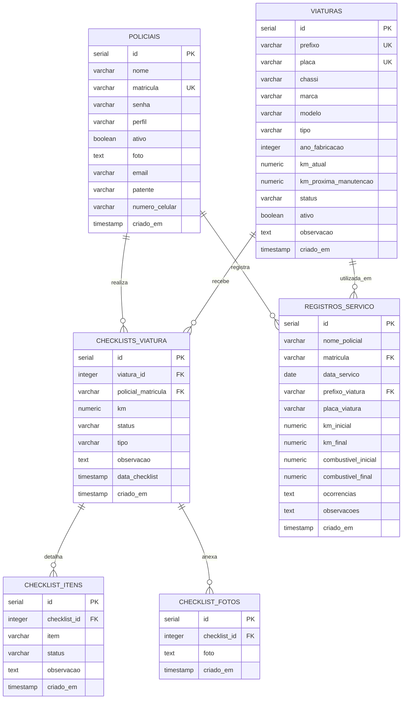

# Documentação Completa do Banco de Dados — Sistema de Controle de Frota PMBA

**Disciplina:** Banco de Dados — Prof. Vagner  
**Autor:** Caio Barreto ([LinkedIn](https://www.linkedin.com/in/caio-barreto-50625a254/))  
**Repositório GitHub:** https://github.com/caiobarreto432/controle-frota-app  
**SGBD:** PostgreSQL 15+  

---

## 1. Mini-Mundo e Objetivo do Sistema

O **Sistema de Controle de Frota PMBA** substitui o controle manual em papel (fichas de pátio e cadernos de plantão) por uma solução centralizada composta por banco de dados relacional **PostgreSQL 15+**, **API REST Node.js/Express** e **aplicativo móvel/web Flutter**.

No cotidiano operacional de uma companhia policial, diferentes militares assumem e devolvem viaturas (carros e motos) ao longo dos turnos. Sem vínculo transacional no banco de dados, ocorriam falhas como divergência de hodômetro, impossibilidade de identificar o turno em que uma avaria surgiu, ausência de comprovação fotográfica e atrasos na manutenção preventiva.

O banco de dados resolve esses gargalos garantindo:
- **Gestão de frota e efetivo:** cadastro completo de viaturas (`CARRO` e `MOTO`) e policiais (`ADMIN` e `POLICIAL`), com controle de status operacional e metas de revisão preventiva por quilometragem.
- **Vistoria dupla rastreável (Saída e Devolução):** obrigatoriedade de registrar o checklist ao retirar (`SAIDA`) e ao devolver (`RETORNO`) a viatura, detalhando individualmente cada item inspecionado e anexando de 1 a 5 fotos comprobatórias quando houver qualquer irregularidade (`PROBLEMA`).
- **Consolidação de turnos e consumo:** histórico auditável ligando policial, viatura, quilometragem inicial/final, abastecimento (litros e valor gasto em `R$`) e ocorrências do serviço.

---

## 2. Regras de Negócio Aplicadas no SGBD

As regras abaixo são impostas diretamente no PostgreSQL por meio de constraints (`UNIQUE`, `CHECK`, `NOT NULL`, `FOREIGN KEY`), além das validações da camada de API:

| Código | Regra de Negócio | Implementação no Banco / Sistema |
|---|---|---|
| **RN01** | **Unicidade de frota e efetivo** | `prefixo` e `placa` em `viaturas` e `matricula` em `policiais` possuem restrição `UNIQUE`, impedindo duplicidade cadastral. |
| **RN02** | **Integridade de hodômetro** | `CHECK (km_atual >= 0)`, `CHECK (km >= 0)`, `CHECK (km_inicial >= 0)` e `CHECK (km_final >= km_inicial)` impedem quilometragem negativa ou regressiva no turno. |
| **RN03** | **Vistoria dupla e prova fotográfica** | Todo checklist classifica o momento como `SAIDA` ou `RETORNO`. Quando o `status` geral ou de item é `'PROBLEMA'`, o fluxo exige justificativa e anexo de 1 a 5 imagens em `checklist_fotos`. |
| **RN04** | **Domínios fechados por `CHECK`** | Restrições em SQL travam `tipo` da viatura (`'CARRO'`, `'MOTO'`), `status` da viatura (`'DISPONÍVEL'`, `'EM MANUTENÇÃO'`, `'RESERVA'`, `'BAIXADA'`), `perfil` (`'ADMIN'`, `'POLICIAL'`), `tipo` de checklist (`'SAIDA'`, `'RETORNO'`) e `status` de vistoria (`'OK'`, `'PROBLEMA'`). |
| **RN05** | **Rastreio de turno e abastecimento** | `registros_servico` vincula `matricula` (`policiais`) e `prefixo_viatura` (`viaturas`), exigindo `combustivel_inicial >= 0` (litros) e `combustivel_final >= 0` (valor em R$), mantendo snapshot histórico de nome e placa. |
| **RN06** | **Ciclo de vida e preservação de auditoria** | Exclusão em cascata (`ON DELETE CASCADE`) remove automaticamente itens e fotos caso um checklist seja apagado (ou uma viatura via DDL); em operação normal utiliza-se exclusão lógica (`ativo = FALSE`) em `viaturas` e `policiais` para preservar o histórico. |

---

## 3. Modelo Entidade-Relacionamento (DER)

O esquema é composto por **6 entidades interligadas**: `policiais`, `viaturas`, `checklists_viatura`, `checklist_itens`, `checklist_fotos` e `registros_servico`.



### Cardinalidades do Modelo
- `policiais (1) ── (N) checklists_viatura` (`policial_matricula -> policiais.matricula`, `ON UPDATE CASCADE`)
- `viaturas (1) ── (N) checklists_viatura` (`viatura_id -> viaturas.id`, `ON DELETE CASCADE`)
- `checklists_viatura (1) ── (N) checklist_itens` (`checklist_id -> checklists_viatura.id`, `ON DELETE CASCADE`)
- `checklists_viatura (1) ── (0..5) checklist_fotos` (`checklist_id -> checklists_viatura.id`, `ON DELETE CASCADE`)
- `policiais (1) ── (N) registros_servico` (`matricula -> policiais.matricula`, `ON UPDATE CASCADE`)
- `viaturas (1) ── (N) registros_servico` (`prefixo_viatura -> viaturas.prefixo`, `ON UPDATE CASCADE`)

---

## 4. Modelo Lógico e Dicionário de Dados

Definições extraídas fielmente de [`scripts/01_ddl.sql`](../scripts/01_ddl.sql):

### 4.1. Tabela `viaturas`
Cadastro oficial das viaturas da frota operacional (carros e motos).

| Coluna | Tipo PostgreSQL | Restrições / Padrão | Descrição |
|---|---|---|---|
| `id` | `SERIAL` | `PRIMARY KEY` | Identificador único sequencial |
| `prefixo` | `VARCHAR(10)` | `NOT NULL UNIQUE` | Código operacional (ex.: `VTR-01`, `MOT-01`) |
| `placa` | `VARCHAR(10)` | `NOT NULL UNIQUE` | Placa do veículo |
| `chassi` | `VARCHAR(50)` | — | Número de chassi |
| `marca` | `VARCHAR(50)` | — | Fabricante (ex.: `Chevrolet`, `Honda`) |
| `modelo` | `VARCHAR(50)` | — | Modelo (ex.: `S10 4x4`, `XRE 300`) |
| `tipo` | `VARCHAR(20)` | `NOT NULL CHECK (tipo IN ('CARRO', 'MOTO'))` | Categoria operacional |
| `ano_fabricacao` | `INTEGER` | `CHECK (ano_fabricacao >= 1980 AND ano_fabricacao <= 2100)` | Ano de fabricação |
| `km_atual` | `NUMERIC(12, 2)` | `NOT NULL DEFAULT 0 CHECK (km_atual >= 0)` | Quilometragem atual registrada |
| `km_proxima_manutencao` | `NUMERIC(12, 2)` | `NOT NULL DEFAULT 10000 CHECK (km_proxima_manutencao >= 0)` | Meta de KM da próxima revisão preventiva |
| `status` | `VARCHAR(20)` | `NOT NULL DEFAULT 'DISPONÍVEL' CHECK (status IN ('DISPONÍVEL', 'EM MANUTENÇÃO', 'RESERVA', 'BAIXADA'))` | Situação atual do veículo |
| `ativo` | `BOOLEAN` | `NOT NULL DEFAULT TRUE` | Controle de exclusão lógica |
| `observacao` | `TEXT` | — | Observações administrativas |
| `criado_em` | `TIMESTAMP` | `NOT NULL DEFAULT NOW()` | Data/hora de criação |

### 4.2. Tabela `policiais`
Efetivo policial autenticado para operação e administração da frota.

| Coluna | Tipo PostgreSQL | Restrições / Padrão | Descrição |
|---|---|---|---|
| `id` | `SERIAL` | `PRIMARY KEY` | Identificador único sequencial |
| `nome` | `VARCHAR(200)` | `NOT NULL` | Nome completo do policial |
| `matricula` | `VARCHAR(20)` | `NOT NULL UNIQUE` | Matrícula funcional (login) |
| `senha` | `VARCHAR(200)` | `NOT NULL` | Hash `bcrypt` da senha |
| `perfil` | `VARCHAR(20)` | `NOT NULL DEFAULT 'POLICIAL' CHECK (perfil IN ('ADMIN', 'POLICIAL'))` | Nível de acesso (RBAC) |
| `ativo` | `BOOLEAN` | `NOT NULL DEFAULT TRUE` | Situação ativa ou inativa (`soft delete`) |
| `foto` | `TEXT` | — | Caminho ou URI da foto de perfil |
| `email` | `VARCHAR(255)` | — | E-mail institucional/contato |
| `patente` | `VARCHAR(50)` | — | Patente/graduação militar |
| `numero_celular` | `VARCHAR(30)` | — | Telefone de contato |
| `criado_em` | `TIMESTAMP` | `NOT NULL DEFAULT NOW()` | Data/hora de criação |

### 4.3. Tabela `checklists_viatura`
Cabeçalho das vistorias operacionais na assunção (`SAIDA`) e devolução (`RETORNO`) da viatura.

| Coluna | Tipo PostgreSQL | Restrições / Padrão | Descrição |
|---|---|---|---|
| `id` | `SERIAL` | `PRIMARY KEY` | Identificador único da vistoria |
| `viatura_id` | `INTEGER` | `NOT NULL REFERENCES viaturas(id) ON DELETE CASCADE` | Viatura inspecionada |
| `policial_matricula` | `VARCHAR(20)` | `NOT NULL REFERENCES policiais(matricula) ON UPDATE CASCADE` | Policial responsável pela vistoria |
| `km` | `NUMERIC(12, 2)` | `NOT NULL CHECK (km >= 0)` | Hodômetro marcado na vistoria |
| `status` | `VARCHAR(20)` | `NOT NULL CHECK (status IN ('OK', 'PROBLEMA'))` | Resultado geral do checklist |
| `tipo` | `VARCHAR(20)` | `NOT NULL DEFAULT 'SAIDA' CHECK (tipo IN ('SAIDA', 'RETORNO'))` | Momento da vistoria no plantão |
| `observacao` | `TEXT` | — | Relato geral do policial |
| `data_checklist` | `TIMESTAMP` | `NOT NULL DEFAULT NOW()` | Data e hora da inspeção |
| `criado_em` | `TIMESTAMP` | `NOT NULL DEFAULT NOW()` | Timestamp de persistência |

### 4.4. Tabela `checklist_itens`
Detalhamento individual de cada componente verificado na vistoria.

| Coluna | Tipo PostgreSQL | Restrições / Padrão | Descrição |
|---|---|---|---|
| `id` | `SERIAL` | `PRIMARY KEY` | Identificador do item inspecionado |
| `checklist_id` | `INTEGER` | `NOT NULL REFERENCES checklists_viatura(id) ON DELETE CASCADE` | Vínculo com o cabeçalho da vistoria |
| `item` | `VARCHAR(200)` | `NOT NULL` | Componente (ex.: `Pneus`, `Luzes`, `Retrovisores`) |
| `status` | `VARCHAR(20)` | `NOT NULL CHECK (status IN ('OK', 'PROBLEMA'))` | Situação específica do componente |
| `observacao` | `TEXT` | — | Detalhe da avaria quando `status = 'PROBLEMA'` |
| `criado_em` | `TIMESTAMP` | `NOT NULL DEFAULT NOW()` | Timestamp de persistência |

### 4.5. Tabela `checklist_fotos`
Caminhos/URLs das evidências fotográficas (até 5 por checklist) anexadas em caso de irregularidade.

| Coluna | Tipo PostgreSQL | Restrições / Padrão | Descrição |
|---|---|---|---|
| `id` | `SERIAL` | `PRIMARY KEY` | Identificador da foto |
| `checklist_id` | `INTEGER` | `NOT NULL REFERENCES checklists_viatura(id) ON DELETE CASCADE` | Vínculo com o checklist |
| `foto` | `TEXT` | `NOT NULL` | Caminho/URL do arquivo de imagem |
| `criado_em` | `TIMESTAMP` | `NOT NULL DEFAULT NOW()` | Timestamp de persistência |

### 4.6. Tabela `registros_servico`
Registro consolidado do turno de serviço com quilometragem, abastecimento e ocorrências.

| Coluna | Tipo PostgreSQL | Restrições / Padrão | Descrição |
|---|---|---|---|
| `id` | `SERIAL` | `PRIMARY KEY` | Identificador do turno |
| `nome_policial` | `VARCHAR(200)` | `NOT NULL` | Snapshot do nome do policial no turno |
| `matricula` | `VARCHAR(20)` | `NOT NULL REFERENCES policiais(matricula) ON UPDATE CASCADE` | FK para matrícula do policial |
| `data_servico` | `DATE` | `NOT NULL` | Data operacional do plantão |
| `prefixo_viatura` | `VARCHAR(10)` | `REFERENCES viaturas(prefixo) ON UPDATE CASCADE` | FK para o prefixo da viatura |
| `placa_viatura` | `VARCHAR(10)` | — | Snapshot da placa da viatura no turno |
| `km_inicial` | `NUMERIC(12, 2)` | `NOT NULL CHECK (km_inicial >= 0)` | Hodômetro na saída |
| `km_final` | `NUMERIC(12, 2)` | `NOT NULL CHECK (km_final >= km_inicial)` | Hodômetro na devolução |
| `combustivel_inicial` | `NUMERIC(10, 2)` | `NOT NULL DEFAULT 0 CHECK (combustivel_inicial >= 0)` | Quantidade abastecida em litros (`L`) |
| `combustivel_final` | `NUMERIC(10, 2)` | `NOT NULL DEFAULT 0 CHECK (combustivel_final >= 0)` | Valor pago no abastecimento (`R$`) |
| `ocorrencias` | `TEXT` | — | Ocorrências e problemas apontados nos checklists |
| `observacoes` | `TEXT` | — | Observações livres do plantão |
| `criado_em` | `TIMESTAMP` | `NOT NULL DEFAULT NOW()` | Data/hora de gravação |

---

## 5. Normalização (`1FN`, `2FN`, `3FN`) e Desnormalização Controlada

1. **Primeira Forma Normal (`1FN`) — Atomicidade:**  
   Atributos multivalorados (lista de itens vistoriados e múltiplas fotos de avaria) foram extraídos de `checklists_viatura` para as tabelas filhas `checklist_itens` e `checklist_fotos`. Cada coluna armazena um valor atômico.
2. **Segunda Forma Normal (`2FN`) — Dependência Total da Chave:**  
   Todas as 6 tabelas utilizam chave primária simples (`id SERIAL`), assegurando que todos os atributos não-chave dependam integralmente da chave primária, sem dependências parciais.
3. **Terceira Forma Normal (`3FN`) — Ausência de Dependências Transitivas e Atributos Derivados:**  
   Dados cadastrais de veículo (`marca`, `modelo`, `ano_fabricacao`, `chassi`) residem exclusivamente em `viaturas`, e dados do efetivo (`patente`, `email`, `numero_celular`) ficam em `policiais`. Campos derivados como `km_rodado`, `km_restante`, `custo_por_km` e `situacao_manutencao` não são armazenados de forma redundante, sendo calculados dinamicamente em consultas DQL (`03_dql.sql`).
4. **Decisão de Desnormalização Controlada (Auditoria Histórica):**  
   Em `registros_servico`, os campos `nome_policial` e `placa_viatura` coexistem com as chaves estrangeiras `matricula` e `prefixo_viatura` como **snapshot documental**. Isso garante que alterações futuras no cadastro (promoção de patente, correção de nome ou troca de placa de um prefixo) nunca alterem retroativamente a folha de serviço de plantões antigos.

---

## 6. Índices B-Tree Criados

O script [`scripts/01_ddl.sql`](../scripts/01_ddl.sql) cria **8 índices B-Tree** para acelerar junções, filtros de histórico e carregamento de evidências:

| Índice | Tabela (`Coluna`) | Finalidade |
|---|---|---|
| `idx_registros_matricula` | `registros_servico(matricula)` | Filtrar "Meus Registros" por policial sem *full table scan* |
| `idx_registros_criado_em` | `registros_servico(criado_em DESC)` | Ordenar o histórico cronologicamente do mais recente ao mais antigo |
| `idx_viaturas_prefixo` | `viaturas(prefixo)` | Busca instantânea e `JOIN` pelo prefixo operacional |
| `idx_viaturas_placa` | `viaturas(placa)` | Consulta rápida de cadastro e validação por placa |
| `idx_checklists_viatura_id` | `checklists_viatura(viatura_id)` | Listar o histórico de vistorias de uma viatura específica |
| `idx_checklists_matricula` | `checklists_viatura(policial_matricula)` | Auditoria de checklists realizados por determinado militar |
| `idx_checklist_fotos_checklist_id` | `checklist_fotos(checklist_id)` | Subconsulta `json_agg` de fotos sem degradação de I/O |
| `idx_checklist_itens_checklist_id` | `checklist_itens(checklist_id)` | Subconsulta `json_agg` dos itens inspecionados |

---

## 7. Scripts Executáveis (`DDL`, `DML` e `DQL`)

### Como executar em um banco PostgreSQL limpo
```bash
psql -U postgres -d controle_frota -f scripts/01_ddl.sql
psql -U postgres -d controle_frota -f scripts/02_dml.sql
psql -U postgres -d controle_frota -f scripts/03_dql.sql
```

### Resumo dos dados de teste (`scripts/02_dml.sql`)
- **Policiais (`5` registros):** 1 `ADMIN` (`301001` — Caio Barreto) e 4 `POLICIAL` (`302045` Lucas Santana, `302089` Mariana Oliveira, `302112` Rafael Costa e `302199` Thiago Almeida, posteriormente desativado via `UPDATE ativo = FALSE`).
- **Viaturas (`5` registros):**
  - `VTR-01` — Chevrolet S10 4x4 (`PKZ1A23`, `CARRO`, atualizada para `45.380 km` / revisão `50.000 km`, status `DISPONÍVEL`)
  - `VTR-02` — Renault Duster 1.6 (`QTW4B56`, `CARRO`, `69.400 km` / revisão `70.000 km`, status `DISPONÍVEL`)
  - `VTR-03` — Toyota Hilux CD (`RJK7C89`, `CARRO`, `31.500 km` / revisão `30.000 km`, status `EM MANUTENÇÃO`)
  - `MOT-01` — Honda XRE 300 (`SLA2D10`, `MOTO`, `18.250 km` / revisão `20.000 km`, status `DISPONÍVEL`)
  - `MOT-02` — Yamaha Lander 250 (`TMB9E34`, `MOTO`, `24.800 km` / revisão `25.000 km`, status `RESERVA`)
- **Checklists (`6` vistorias):** pares `SAIDA`/`RETORNO` para `VTR-01` (nova avaria no retorno: farol dianteiro direito queimado + evidências fotográficas), `VTR-02` (saída e retorno `OK`) e `MOT-01` (problema pré-existente no retrovisor esquerdo), além de `checklist_itens`, `checklist_fotos` (com exemplo de `DELETE` de foto duplicada) e `4` lançamentos em `registros_servico`.

### Consultas analíticas (`scripts/03_dql.sql`)

| Query | Objetivo | Recursos SQL Utilizados |
|---|---|---|
| **Q01** | Painel de manutenção preventiva (`VTR-03 VENCIDA (-1500 km)`, `MOT-02` e `VTR-02 PROXIMA`, `MOT-01` e `VTR-01 NORMAL`) | `CASE`, cálculo aritmético, `WHERE ativo = TRUE`, `ORDER BY` |
| **Q02** | Consolidado de turnos, KM rodado, litros e gasto por viatura | `LEFT JOIN`, `COUNT`, `SUM`, `COALESCE`, `GROUP BY` |
| **Q03** | Ranking de policiais por quilometragem percorrida e média por turno | `INNER JOIN`, `SUM`, `ROUND(AVG(...), 2)`, `GROUP BY` |
| **Q04** | Histórico completo de checklists (`SAIDA` vs `RETORNO`) | `INNER JOIN` triplo, concatenação (`\|\|`), ordenação temporal |
| **Q05** | Auditoria de itens com `PROBLEMA` e contagem de fotos anexadas | `INNER JOIN` quádruplo + `LEFT JOIN checklist_fotos`, `COUNT` |
| **Q06** | Detecção de novas avarias no plantão (Saída `OK` → Devolução `PROBLEMA` — identifica `VTR-01`) | *Self-join* em `checklists_viatura` por viatura, matrícula e data |
| **Q07** | Viaturas com custo de abastecimento acima de R$ 100,00 e custo por KM (`VTR-02` e `VTR-01`) | `GROUP BY`, `HAVING SUM(...) > 100`, `NULLIF` |
| **Q08** | Payload hierárquico padrão da API com itens e fotos aninhados | Subconsultas correlacionadas + `json_agg` + `json_build_object` |
| **Q09** | Distribuição do efetivo ativo por perfil (`ADMIN` = 1, `POLICIAL` = 3) | `WHERE ativo = TRUE`, `COUNT(*)`, `GROUP BY perfil` |
| **Q10** | Relatório de turnos que registraram ocorrências/avarias | `WHERE ocorrencias IS NOT NULL AND TRIM(ocorrencias) <> ''` |

---

## 8. Segurança e Integração Full-Stack

- **Autenticação e transporte:** senhas armazenadas com hash `bcrypt` no PostgreSQL; emissão de tokens **JWT** armazenados no dispositivo via `FlutterSecureStorage` (Android Keystore / iOS Keychain), trafegados exclusivamente sobre **HTTPS/TLS** com validação alfanumérica prévia da matrícula e *rate limiting* (`express-rate-limit`) na API Node.js.
- **Consistência transacional:** gravações compostas (cabeçalho de checklist + lista de itens + upload multipart de até 5 fotos) executam em blocos `BEGIN / COMMIT / ROLLBACK` no `pg`, garantindo atomicidade.
- **Portabilidade de relatórios:** a classe `ExcelExporter` gera planilhas `.xlsx` nativas offline (para registro de turno individual, checklists Saída/Retorno ou consolidado de histórico filtrado por período) e compartilha via `SharePlus`.
